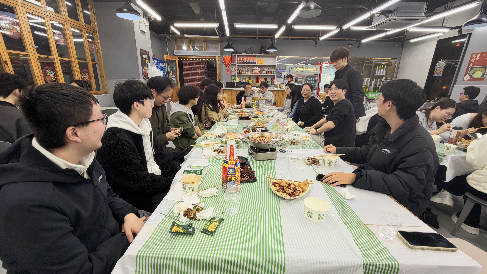
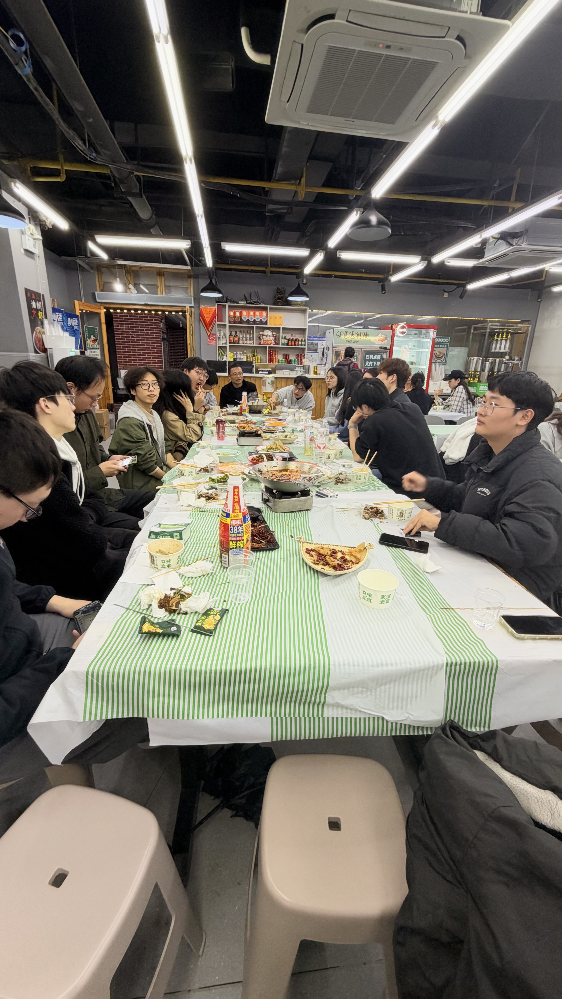
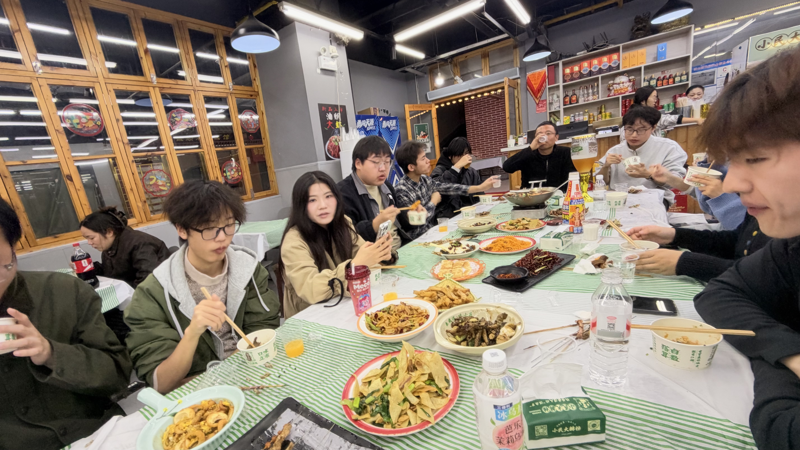
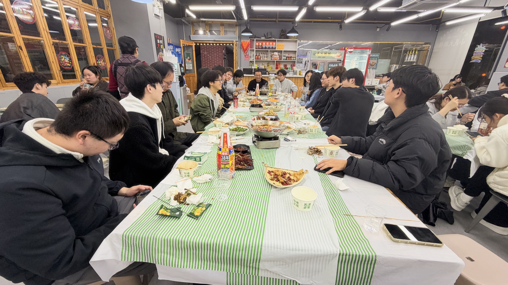

## English

On November 12, 2026, the team held an autumn outing and team-building gathering. Members came together for a group dinner, enjoying food and conversation in a relaxed and welcoming atmosphere.

The gathering offered everyone an opportunity to step away from busy research and study schedules, share recent experiences, and get to know one another better. The lively interaction strengthened friendships among team members and further enhanced the team's sense of belonging and cohesion.

## Activity Photos / 活动照片

  
  
  
  

## 中文

2026年11月12日，团队开展秋游团建活动。成员们欢聚一堂，共享美食、畅谈近况，在轻松融洽的氛围中交流科研学习与日常生活感受。

此次活动为大家提供了在繁忙科研学习之余放松交流的机会。成员们在愉快的互动中进一步增进了解、加深友谊，增强了团队的归属感与凝聚力，营造了团结友爱、积极向上的团队氛围。
