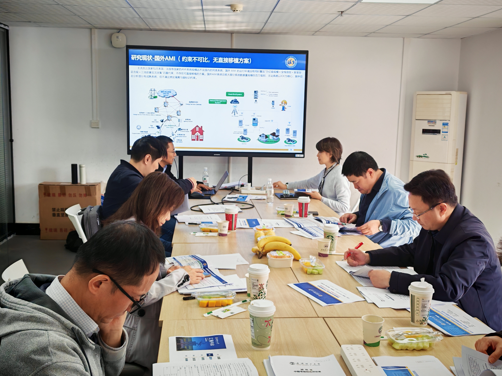
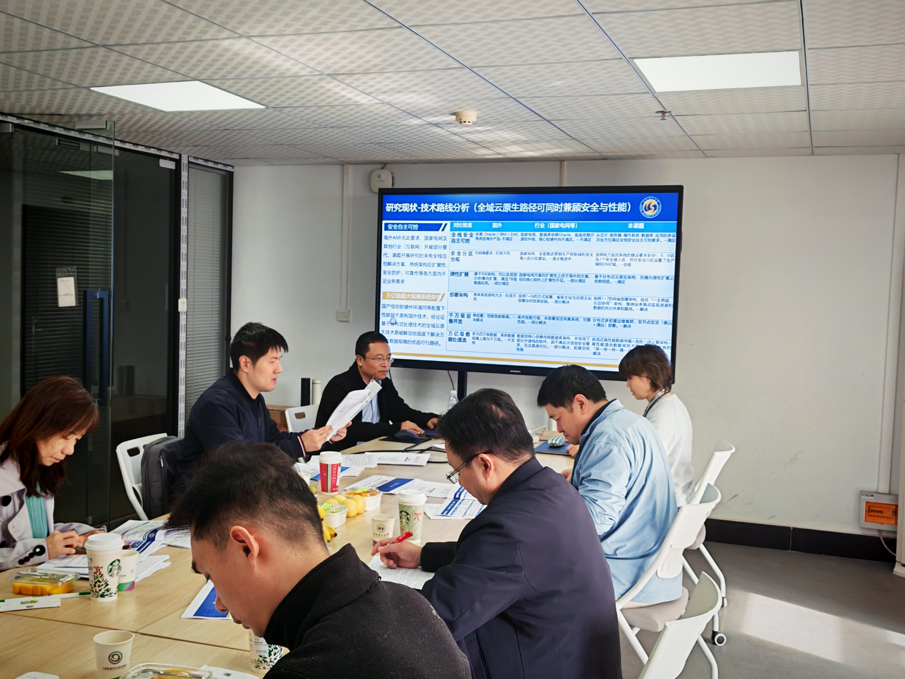

## English

On November 11, 2026, the team held a doctoral research proposal defense. Doctoral students presented their proposed research, explaining the research background, objectives, methodology, and planned work to the review panel and attendees.

During the discussion, the reviewers examined the proposals, raised questions, and offered constructive suggestions on research design, technical approaches, and the organization of subsequent work. The academic exchange helped the students further clarify their research directions and improve their plans for the next stage.

## Activity Photos / 活动照片

  
  
  
  

## 中文

2026年11月11日，团队举行博士研究生开题答辩。答辩过程中，博士生围绕研究背景、研究目标、研究方法与后续计划等内容进行汇报，向评审专家和参会人员系统介绍拟开展的研究工作。

在交流讨论环节，评审专家认真审阅开题内容，围绕研究设计、技术路线及后续工作安排提出问题和建设性意见。此次学术交流帮助博士生进一步明晰研究方向、完善研究方案，为下一阶段研究工作的有序开展奠定了基础。
