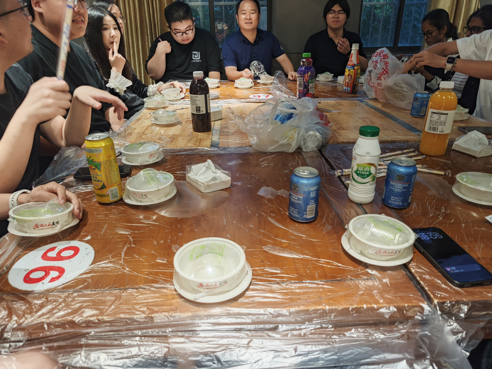
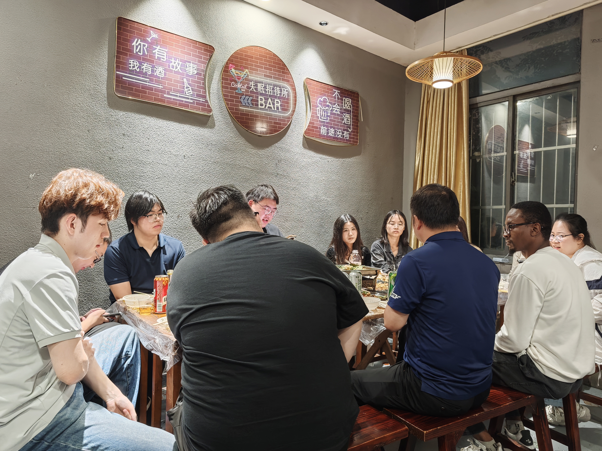

## English

On September 28, 2026, thirty lab members came together for a barbecue dinner in a relaxed and friendly atmosphere. Gathering around the table, members enjoyed delicious food, shared recent experiences, and exchanged thoughts on research, academic life, and everyday activities. The dinner provided an opportunity to unwind from busy research schedules while fostering friendship and stronger connections among team members.

Throughout the evening, lively conversations and warm interactions created a welcoming atmosphere. New and senior members had the opportunity to get to know one another better and strengthen their relationships. The gathering enriched the team's social life, promoted a supportive and collaborative environment, and further enhanced the sense of belonging and unity within the lab.

## Activity Photos / 活动照片

  
  

## 中文

2026年9月28日，30名团队成员齐聚一堂，开展了一场轻松愉快的烧烤聚餐活动。大家围坐在一起，共享美食、畅谈近况，在温馨融洽的氛围中交流学习与科研心得，分享日常生活中的趣事与感悟。此次聚餐不仅让大家在繁忙的科研学习之余放松了身心，也为团队成员提供了增进了解、加深友谊的良好机会。

聚餐过程中，大家畅所欲言，现场气氛热烈而融洽。新老成员在轻松的交流中拉近了彼此的距离，进一步加深了相互了解与情感联系。此次活动丰富了团队成员的课余生活，营造了团结友爱、积极向上的团队氛围，进一步增强了团队的归属感与凝聚力。
